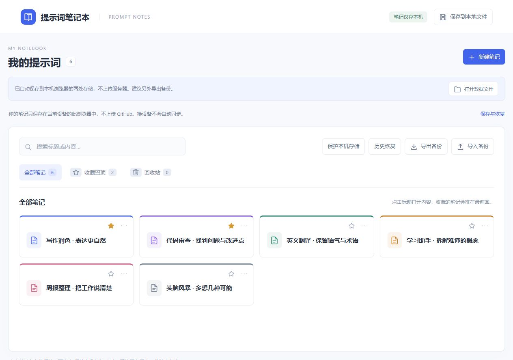

# 提示词笔记本 · Prompt Notes

一个轻量的提示词管理工具（Prompt Manager），帮你收集、整理和复用 ChatGPT、Claude、Gemini 等 AI 工具的常用提示词。本地优先，打开就能用。

A lightweight, local-first prompt manager. Save, search, organize and copy your AI prompts — no account required, notes stay in your browser.

好用的提示词，值得有个随手就能找到的地方。

把写作、学习、编程时反复用到的提示词放进来，起个名字，选个颜色。下次需要时，搜一下、点开、复制，就能接着用。

**[打开提示词笔记本 →](https://wu-make.github.io/prompt-notes/)**

*主页预览，图中为演示笔记。打开网站后，可以建立自己的提示词库。*

免费使用，无需注册，也不用安装。把网址加入收藏夹，就是你自己的提示词本。

## 我们更喜欢简单、高效

通用笔记工具适合整理各种资料。这个小本子更专注：让你用更少的步骤，存好提示词、找到提示词、用上提示词。

我们把日常最常用的功能放在顺手的位置。主页只展示标题，找笔记时一眼就能扫过去；常用的收藏置顶，不同用途用颜色区分；记不清标题，直接搜正文里的关键词。打开后点一下复制，就能粘贴到你正在使用的 AI 工具里。

页面简单，功能也要齐全。从新建、编辑到搜索、整理、备份，一页就能完成。我们觉得，工具顺手、用着省心，比折腾一套复杂的整理方法更重要。

## 该有的，都在这里

| 功能 | 用起来有什么方便 |
| --- | --- |
| 标题主页 | 只看标题，清爽好找，点击就能打开全文 |
| 自动保存 | 随写随存，下次在同一浏览器打开，接着用 |
| 一键复制 | 整段提示词直接复制，保留原来的换行 |
| 搜索笔记 | 标题和正文都能搜，想起几个字也能找到 |
| 颜色分类 | 六种颜色，按用途或习惯自由整理 |
| 收藏置顶 | 常用笔记放在最前面，也能单独查看收藏 |
| 回收站 | 删掉的笔记可以找回来，需要整理时一键清空 |
| 导出与导入 | 用一个 JSON 文件备份、迁移，也能与离线版互相导入 |
| 历史恢复 | 需要回看时，从近期保存的版本里选择恢复 |
| 离线使用 | 首次联网打开并缓存后，断网也能继续整理笔记 |

## 怎么用

1. **新建一条。** 点击「新建笔记」，写好标题，把提示词粘贴进去；修改会自动保存。
2. **整理一下。** 右键笔记卡片，或点击右上角的「…」，就能重命名、换颜色、收藏或删除。点击星标也能快速收藏置顶。
3. **随时取用。** 在主页搜索标题或内容，点开需要的笔记，再点击复制按钮。
4. **管理回收站。** 删除后的笔记会进入「回收站」，可以恢复；点击「一键清空」并确认，就能清理回收站里的全部笔记。
5. **留一份备份。** 点击「导出备份」保存文件，需要时用「导入备份」读回来。导入会添加新笔记，自动跳过已有的重复笔记。

## 笔记留在自己的电脑上

每位使用者都有自己的笔记本，内容保存在各自的浏览器中，不会上传到我们的服务器，也不会展示给其他访客。打开网站就能开始记录，无需账号、登录或配置。

想让笔记另外保存成电脑里的文件，可以在支持的 Chrome、Edge 浏览器中点击右上角「保存到本地文件」，选好位置，后续修改也会写入这个文件。再次打开时，可以用「打开数据文件」继续使用。

日常使用时，也可以点击「保护本机存储」申请浏览器的存储保护。想换一台电脑继续整理，就导出备份，在新电脑上打开网站后导入。网页版和离线版使用相同的备份格式，可以互相导入。

## 觉得顺手，就留个 Star

如果它帮你省下了翻找提示词的时间，欢迎点一下仓库右上角的 **Star**，也方便以后找到这个项目。用着有什么想法，可以到 [Issues](https://github.com/wu-make/prompt-notes/issues) 聊聊；也欢迎把它分享给同样经常使用 AI 的朋友。
